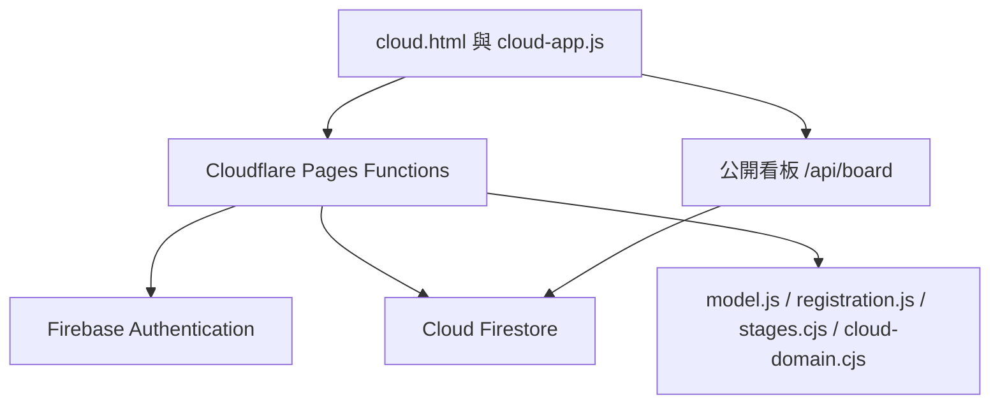

# 賽乒乓｜協同開發交接與架構

這份文件供 `tballgame/tball` 的協作者及其 AI 閱讀，作為接手開發的起點。GitHub 專案 `https://github.com/tballgame/tball` 的 `main` 是本範本來源。不要以其他倉庫或工作區中的舊副本取代它。本文件撰寫時程式版本為 `0.7.13`。

## 重要開發順序

**所有共用功能先在 `tballgame/tball` 範本開發。完成檢查、確認符合需求後，才將確認過的變更同步到 `tball-t1`。** 不要先改 t1，也不要把未確認的範本變更直接發佈到 t1。t1 是獨立球團環境，會員、賽事資料與 Firebase 專案設定均須和範本分離；同步程式時不得覆蓋 t1 專屬設定或資料。

建議節奏：範本分支開發 → PR/檢閱 → 確認功能與資料相容性 → 使用者確認 → 將核准的程式變更同步至 t1 → 再依授權部署。若只為範本測試而加入示範賽事或模擬結果，必須先確認資料寫入的是範本測試環境，不可因此改動 t1 真實資料。

## 專案與協作權限

### 本文件如何共同維護

- 本文件應一併存放於 `tballgame/tball` GitHub 倉庫根目錄，與程式碼共同版本管理；它是協作者及其 AI 接手時的共同開發基準。
- 文件的後續修訂也使用功能分支與 PR，讓其他協作者可以檢閱並保留版本歷程；不要只在個人電腦改一份而未同步到 GitHub。
- GitHub 倉庫中的版本是共同維護的正式版本。E 槽 `乒乓實程控制系統\DEVELOPMENT_HANDOFF.md` 是本機參考副本，文件更新後應一併同步，保持兩份內容一致。
- 修改待辦、角色規則、架構或範本→t1 發佈順序時，應同時更新本文件，並標示已完成/未完成及相關提交。

- 主要協作倉庫：`tballgame/tball`（私有範本）。使用者會在此倉庫加入協作者；協作者應以分支與 PR 開發，避免多人直接推送 `main`。
- t1 是範本確認後才更新的獨立部署，不是範本來源，也不是共用資料庫。
- 不使用或依賴 `iceapp-maker/tball` 作為本專案來源或協作目標。
- **寫程式只需要 GitHub 倉庫權限，不需要 Firebase 或 Cloudflare 金鑰。** 只有需要操作 Firebase 專案資料/設定或 Cloudflare Pages/部署時，才另行授予最低必要的服務權限。
- 協作者的 AI 若要自行讀取 GitHub 程式，需由協作者在自己的 AI 工具中連接 GitHub；這不需要分享服務金鑰。

## 機密與環境安全

- 不提交、貼到對話或傳給協作者：服務帳戶 JSON 私鑰、Cloudflare Secrets、登入資料、會員個資、正式球團賽事資料。
- Cloudflare 執行期 Secrets 包括 `GOOGLE_SERVICE_ACCOUNT`、`TBALL_SESSION_KEY`、`TBALL_OWNER_UID` 等；實際值只存於對應部署環境，不放 Git。
- `firebaseConfig.js` 是瀏覽器端 Firebase SDK 設定，不是服務帳戶私鑰；但它決定連線的 Firebase 專案。範本與 t1 必須確認各自指向正確的球團專案，切勿在同步程式時覆蓋球團專屬設定。
- 大會管理員由對應環境的 `TBALL_OWNER_UID` 指定。不要自行改成「第一位註冊者就是正式管理員」，除非使用者明確確認此產品規則。

## 架構概覽

### 前端、建置與部署入口

- `cloud.html`：主要頁面結構及樣式。
- `cloud-app.js`：畫面產生、表單操作、呼叫 API 及公開看板刷新。
- `guide.html`：使用者操作說明頁。
- `build-pages.cjs`：將部署需要的 HTML/JS 複製至 `pages-dist/`。
- `pages-dist/` 是建置產物，已由 `.gitignore` 排除，不是原始碼目錄；`wrangler.toml` 指定它為 Pages 輸出目錄。
- `package.json` 提供 `npm run build` 和 `npm test`。修改來源檔後，部署建置會重新產生 `pages-dist/`。

### Pages Functions 與資料層

- `functions/api/account.js`：註冊、登入、登出、session 查詢、重設登入代號。
- `functions/api/registration.js`：會員名冊、賽事讀寫、操作角色檢查與示範操作入口。
- `functions/api/board.js`：公開看板，只讀指定 event ID，使用 Cloudflare Cache API 做約 10 秒快取。
- `firebase-auth.mjs`、`worker-google.mjs`：Firebase Authentication 和服務端 Google OAuth token/session。
- `firebase-store.mjs`：Firestore REST 讀寫；目錄/名冊位於 `tballPrivate/catalog`，賽事文件位於 `tballEvents/{eventId}`，並以版本資訊偵測並行更新衝突。
- `firestore.rules`：Firestore 規則。調整前先確認目前服務端呼叫方式與資料安全需求。

### 賽事領域模組

- `model.js`：團體賽模型、出賽名單、各點比分驗證、團體結果與排名基礎邏輯。
- `registration.js`：報名、組隊、隊長/隊員、賽事鎖定與轉換。
- `stages.cjs`：階段、分組、循環賽賽程、手動對戰、階段排名及冠軍/季軍安排。
- `cloud-domain.cjs`：把 API 動作套用到領域模型，集中檢查角色權限與資料狀態。
- `catalog.cjs`：會員/賽事目錄、資料整理與畫面所需 view model。
- `knockout-board.mjs`：淘汰賽樹狀看板。
- `member-reset.mjs`：大會協助重設會員登入代號。
- `seeded-demo.cjs`、`invitational-demo.cjs`：範本測試示範賽事與模擬結果；須維持範本站/大會權限限制，不可在一般球團公開啟用。

## 產品規則與角色

- 訪客可以看公開賽況看板，不可讀取私人會員名冊或進行管理操作。
- 會員使用 Firebase Authentication 登入；登入代號、會員編號與比賽公開名稱分開。賽事公開畫面不得洩漏登入代號。
- 隊長權限依賽事隊伍資料判斷；不得只憑公開名稱推斷隊長身分。
- 大會權限須由後端驗證，前端隱藏按鈕不是安全措施。
- 試用角色切換與示範會員是協助理解介面的試用功能，不應改變正式球團的角色授權政策。
- 本產品會員與賽事資料使用 Firebase/Firestore，不使用 Cloudflare D1 作為會員資料庫。

## 近期開發脈絡

以下是主要方向摘要，實際功能以當前程式碼與 Git 記錄為準：

- `0378269`：將 `tballgame/tball` 轉為 Firebase 球團範本。
- `902a791`、`0ebfe36`、`8736f74`：淘汰賽樹狀看板與四強、冠季賽展示。
- `c181a3e`：公開看板短快取及種子示範賽。
- `2f667a1`、`62342bd`、`01b9326`、`5f375c3`：六隊雙打模擬、級數搭配與循環賽排名展示修正。
- 賽務流程包含報名、組隊、隊長排點、逐點比分、異議、大會處理、階段排賽、排名與完賽紀錄。
- 公開看板與會員/隊長/大會畫面具有不同用途；修改賽事資料模型時要檢查各種視圖是否一致。

## 已確認但尚待實作的需求

使用者目前先測試並逐項累積待辦，之後再一起修正。以下尚未完成，不要誤認為現有功能：

1. **首輪賽制選擇**：大會建立賽事後明確選「循環賽（系統自動排定）」或「淘汰賽／大會排定（手動排定）」。大會選擇前不顯示可能混淆的賽程預覽。
2. **空白首輪取消或更換賽制**：尚未有對戰、出賽名單、比分、異議或依賴它的後續階段時，允許取消空白首輪/更換賽制。若已有依賴資料，需阻止或清楚處理關聯資料，避免資料遺失或留下孤立階段。
3. **跨階段連續場次與逐點編號**：每場賽事的場次從 1 開始，後續階段接續編號，不重置；每點 ID 為 `場次-點次`，例如 `10-1`。供紙本查找及大會快速輸入比分。已發出的場次編號即使場次刪除也不可重用；實作前需確認資料遷移和舊賽事顯示方式。
4. **循環賽團體積分新制**：保留現有依各點勝點累計的排名方式，增加另一種：團體對戰勝隊 2 分、敗隊 1 分、未到/棄權隊 0 分。相同積分時的排序與同分處理規則尚未確認，實作前需先和使用者確認並在介面說明。

## 接手與交付注意事項

1. 先確認 GitHub `tballgame/tball` 最新 `main`、工作樹與提交狀態，再開始改動。
2. 先追蹤功能的完整路徑：前端 → API → 權限檢查 → 領域邏輯 → Firebase 儲存 → 各種視圖/公開看板。
3. 涉及資料模型時，檢查舊資料相容性、並行更新衝突及已完成賽事。不要只修改前端顯示。
4. 專案提供 `npm test`、`npm run build`；依任務需要執行並回報結果，不要只宣稱已驗證。
5. 透過 PR 說明功能、資料相容性、測試結果及是否需要服務端設定。未獲明確授權前，不操作正式球團資料、不改正式 Secrets、不合併/部署正式網站。
6. 使用者已要求 README 不放展店流程。展店由未來的 Super Admin 展店精靈負責；本文件只記錄開發協作資訊，不取代展店精靈。
